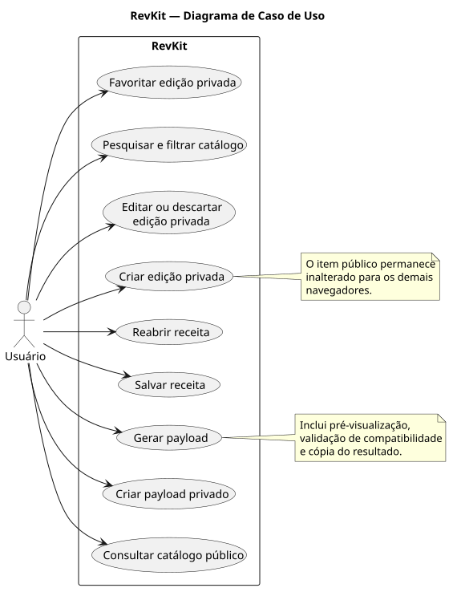
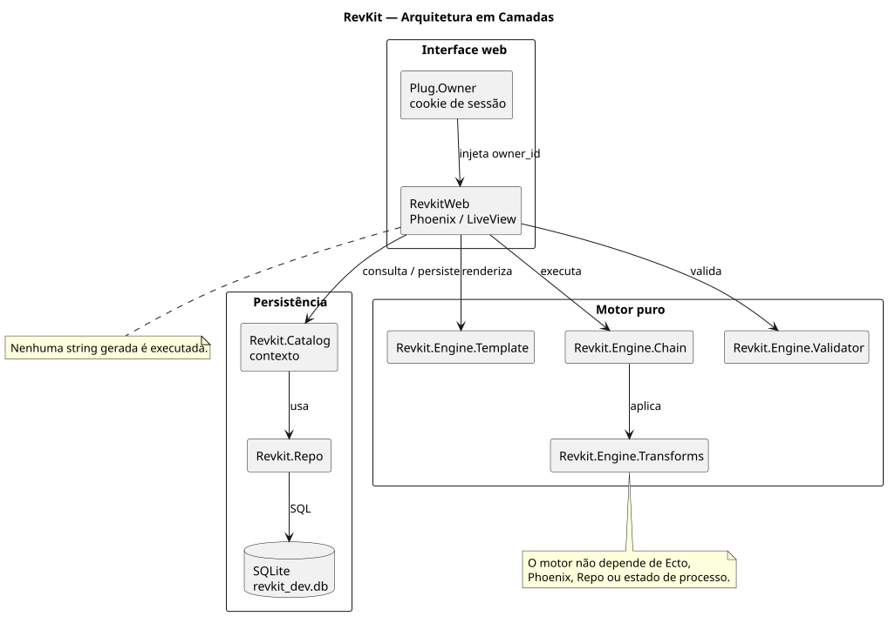
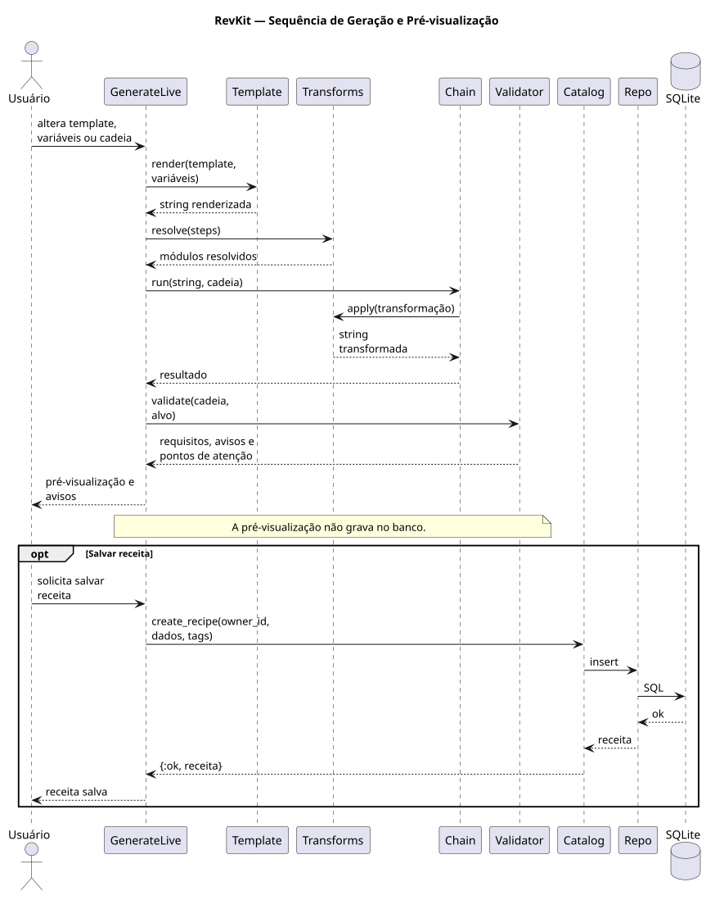

# Diagramas

Diagramas do RevKit em português. As fontes estão em PlantUML e as imagens são
geradas em SVG e PNG.

Os nomes de tabelas, colunas e módulos permanecem iguais aos do código para
facilitar a rastreabilidade entre a documentação e a implementação.

## Diagrama de Caso de Uso



[SVG](casos-de-uso.svg) · [PNG](casos-de-uso.png) · [Fonte PlantUML](casos-de-uso.puml)

## DER


[SVG](der.svg) · [PNG](der.png) · [Fonte PlantUML](der.puml)

O DER usa tipos lógicos. No SQLite, `JSON` e `DATETIME` são armazenados como
`TEXT`, e `BOOLEAN` como `INTEGER`.

## Arquitetura em Camadas



[SVG](arquitetura.svg) · [PNG](arquitetura.png) · [Fonte PlantUML](arquitetura.puml)

## Sequência de Geração



[SVG](sequencia-geracao.svg) · [PNG](sequencia-geracao.png) · [Fonte PlantUML](sequencia-geracao.puml)

## Implantação


[SVG](implantacao.svg) · [PNG](implantacao.png) · [Fonte PlantUML](implantacao.puml)

## Como regenerar

Instale o PlantUML e o Graphviz:

```bash
sudo pacman -S --needed plantuml graphviz
```

Gere todas as imagens:

```bash
./build.sh
```

Também é possível usar um jar do PlantUML sem instalar o pacote do sistema:

```bash
PLANTUML_JAR=/caminho/plantuml.jar ./build.sh
```
