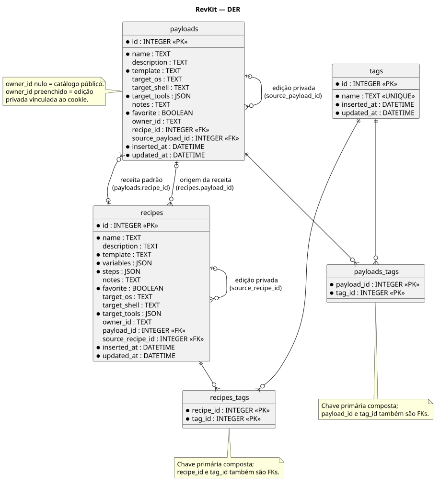
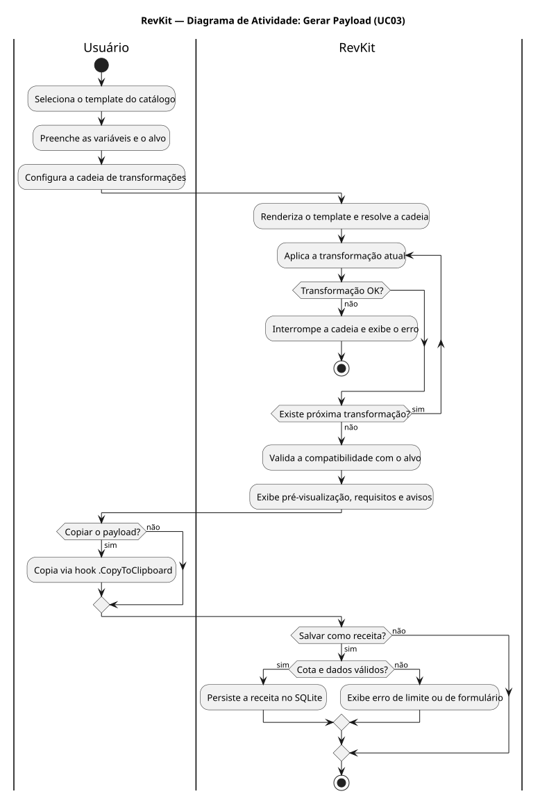
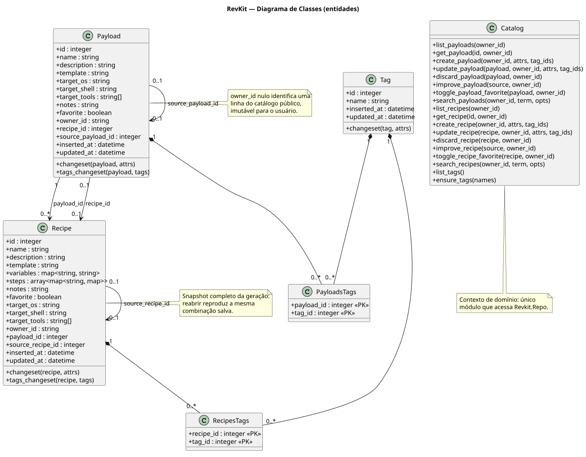
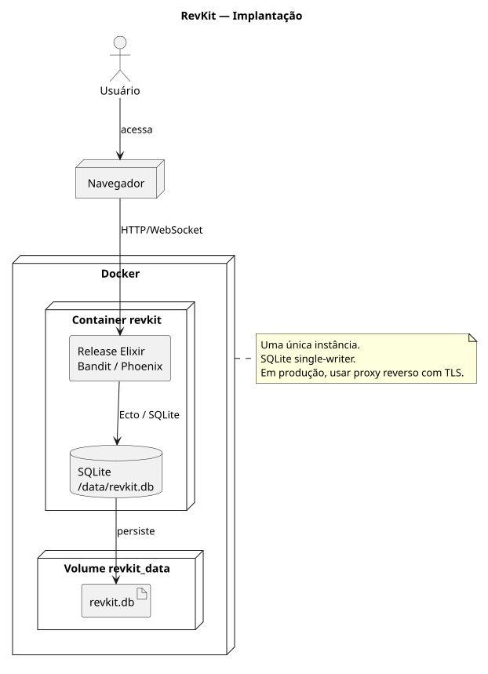

# Diagramas

Diagramas do RevKit em português. As fontes estão em PlantUML e as imagens são
geradas em SVG e PNG.

## Diagrama de Caso de Uso


[SVG](casos-de-uso.svg) · [PNG](casos-de-uso.png) · [Fonte PlantUML](casos-de-uso.puml)

## DER



[SVG](der.svg) · [PNG](der.png) · [Fonte PlantUML](der.puml)

Tipos lógicos; no SQLite, `JSON` e `DATETIME` são `TEXT` e `BOOLEAN` é
`INTEGER` (vide seção de modelo de dados na documentação).

## Arquitetura em Camadas


[SVG](arquitetura.svg) · [PNG](arquitetura.png) · [Fonte PlantUML](arquitetura.puml)

## Diagrama de Atividade



[SVG](atividade.svg) · [PNG](atividade.png) · [Fonte PlantUML](atividade.puml)

## Diagrama de Classes



[SVG](classes.svg) · [PNG](classes.png) · [Fonte PlantUML](classes.puml)

## Diagramas de Sequência por Caso de Uso

Cada caso de uso (UC01–UC09) tem um diagrama próprio:

- [UC01 — Consultar catálogo público](sequencia-uc01.svg) · [PNG](sequencia-uc01.png) · [Fonte](sequencia-uc01.puml)
- [UC02 — Criar payload privado](sequencia-uc02.svg) · [PNG](sequencia-uc02.png) · [Fonte](sequencia-uc02.puml)
- [UC03 — Gerar payload](sequencia-geracao.svg) · [PNG](sequencia-geracao.png) · [Fonte](sequencia-geracao.puml)
- [UC04 — Salvar receita](sequencia-uc04.svg) · [PNG](sequencia-uc04.png) · [Fonte](sequencia-uc04.puml)
- [UC05 — Reabrir receita salva](sequencia-uc05.svg) · [PNG](sequencia-uc05.png) · [Fonte](sequencia-uc05.puml)
- [UC06 — Criar edição privada](sequencia-uc06.svg) · [PNG](sequencia-uc06.png) · [Fonte](sequencia-uc06.puml)
- [UC07 — Editar ou descartar edição privada](sequencia-uc07.svg) · [PNG](sequencia-uc07.png) · [Fonte](sequencia-uc07.puml)
- [UC08 — Pesquisar e filtrar catálogo](sequencia-uc08.svg) · [PNG](sequencia-uc08.png) · [Fonte](sequencia-uc08.puml)
- [UC09 — Favoritar edição privada](sequencia-uc09.svg) · [PNG](sequencia-uc09.png) · [Fonte](sequencia-uc09.puml)

## Implantação



[SVG](implantacao.svg) · [PNG](implantacao.png) · [Fonte PlantUML](implantacao.puml)

## Como regenerar

Instale o PlantUML e o Graphviz:

```bash
sudo pacman -S --needed plantuml graphviz
```

Gere todas as imagens:

```bash
./build.sh
```

Também é possível usar um jar do PlantUML sem instalar o pacote do sistema:

```bash
PLANTUML_JAR=/caminho/plantuml.jar ./build.sh
```
